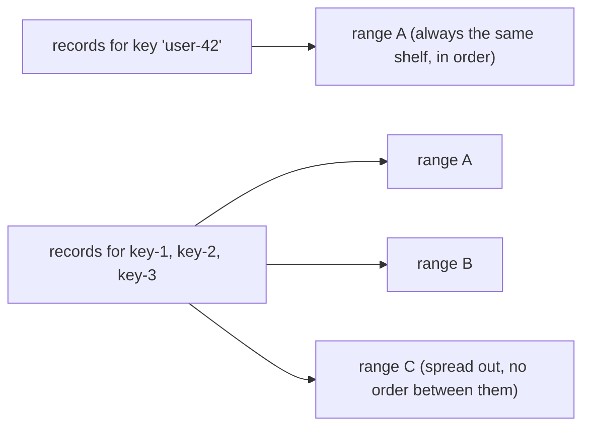
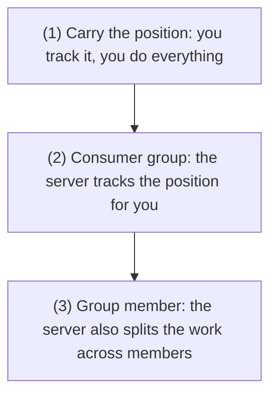
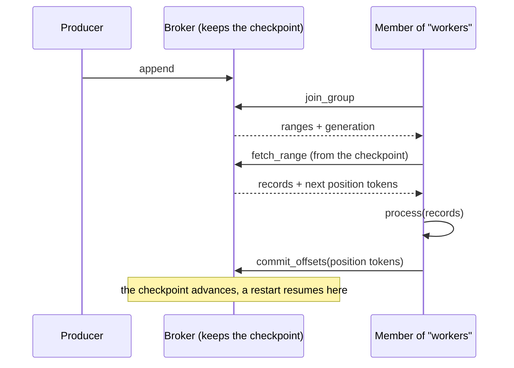
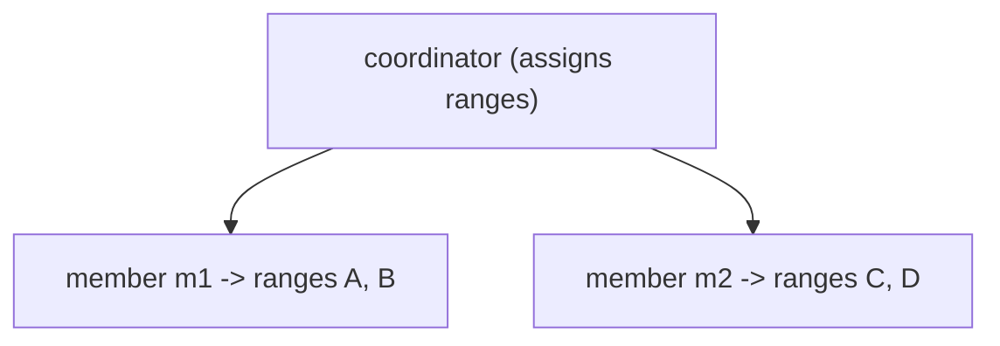

# Produce and consume

[Getting started](getting-started.md) showed the shortest path to a record landing and coming back. This
guide is the working detail: how keys decide ordering, the three ways to track a position, what
at-least-once obliges you to do, and the errors a correct client must expect. The Elixir samples use
`Malachi.Loadtest.Client` from an `iex -S mix` session, connected as in
[Getting started](getting-started.md):

```elixir
alias Malachi.Loadtest.Client
alias Malachi.Log.Record

{:ok, client} =
  Client.connect(host: "127.0.0.1", port: Malachi.TCPAcceptorPool.port(), user: "app", pass: "app123")

:ok = Client.create_topic(client, "orders", 8)
```

## Producing

A record is a value, an optional key, and optional headers (`Malachi.Log.Record.new/2`):

```elixir
Client.produce(client, "orders", [Record.new("created", key: "user-42", headers: [{"source", "api"}])], 5_000)
#=> {:ok, 1}
```

The reply is a **count, not an offset**: `{:ok, count}` once every record was acknowledged within the
timeout, or `{:error, %{acked: n, failed: %{reason => records}, unanswered: n}}`. Nothing in the produce
path hands the client a position, which is what lets ranges split underneath without breaking anyone.

Underneath, the client reads the topic's routes, hashes each key to its range, and appends to each range
on a **producer stream** opened at the broker that leads the range's active segment. Each append carries a
sequence number, and the broker answers with `append_ack` pushes and a window, in appends and inflated
bytes, that it grants at the handshake and adjusts on every ack, so a producer pipelines only as far as
the broker lets it.

> **Analogy.** You get a receipt that says "3 items stored", not "shelf 7, slot 12". The broker keeps the
> right to rearrange the shelves, so it never tells you a slot number you might come to depend on.

### Batch, don't loop

`Client.produce/4` takes a list, and each range's share of it goes out as one append: one round trip and
one quorum wait per range. Appending 100 records one call at a time pays that cost 100 times:

```elixir
events = for i <- 1..100, do: %{user: "user-#{rem(i, 10)}", body: "event #{i}"}

# one append per range the keys land in
{:ok, 100} = Client.produce(client, "orders", Enum.map(events, &Record.new(&1.body, key: &1.user)), 5_000)
```

From the shell, `node producer.js orders 100` appends 100 records in one go; `scripts/loadtest.js` and
`mix malachi.loadtest` take `--pipeline`, `--linger-ms` and `--linger-bytes` to pipeline appends and join
several batches into one.

### Keys decide ordering, not delivery

A key hashes to a position in the topic's keyspace, and that position lands in exactly one range. Records
with the same key therefore go to the same range and are **ordered relative to each other**.



> **Analogy.** A key is what you file under, like a surname. Everything for "user-42" goes in the same
> drawer, in order. Records under many different names scatter across drawers to be filed faster, with no
> order between them.

A key is not an address and not a filter. There is no "read the records for key X"; a consumer reads
ranges, and a range holds many keys. If you need per-entity streams, the entity is the key and you filter
client-side, or you use a topic per entity class.

A record without a key is hashed like any other (its key is `nil`), so every keyless record of a topic
lands in the same range. To spread records across ranges, which maximises parallelism and gives you **no**
ordering between them, give them many distinct keys: `producer.js` names a record without `--key`
`key-<n>` for exactly that reason.

## Consuming

Three ways to track position, in increasing order of what the server does for you.



> **Analogy.** These are three levels of service. Level 1 is do-it-yourself, you keep your own place. Level
> 2 is a shared bookmark the server holds. Level 3 also hands each teammate a section, so the group reads
> the topic in parallel.

### 1. Carry the position yourself

```elixir
{:ok, %{values: values, positions: positions}} = Client.read(client, "orders")
```

A read goes through every active range, from the start of its history, until each one answers a page with
nothing new. `positions` holds, per range, where its next page starts, as an opaque token: compare two
with `Client.compare_positions/2`, and hand one back to resume, but never compute one. Nothing on the server remembers it: the position lives in your process, so it dies with
your process. Good for a one-off scan or an export. `node consumer.js orders` does the same from the shell,
holding each range's position in the script.

> **Analogy.** This is holding your place with your own finger. It works while you are reading, but the
> moment you close the book (your process exits) the place is lost. Nobody else can pick up where you were.

### 2. Consumer group: the server keeps the checkpoint

```elixir
{:ok, %{generation: generation, ranges: ranges}} = Client.join(client, "orders", "workers", "w1")
{:ok, %{values: values, positions: positions}} =
  Client.read(client, "orders", start_from: {:committed, "workers"}, ranges: ranges)
Enum.each(values, &IO.puts/1)
:ok = Client.commit(client, "orders", "workers", "w1", generation, positions)
```

`join_group` hands the member its ranges, a generation and a session. The member reads those ranges from
the group's checkpoint, and `commit_offsets` checkpoints the position it reached in each one, at the
generation it was handed them at. The checkpoint is durable, so a restart resumes where the group left
off. **Commit after you process**, never before, or a crash silently skips records. `Client.leave/4`
takes the member out of the group at once, so its ranges go to the others without waiting out its
session.



> **Analogy.** A consumer group is a shared to-do list where the server holds the bookmark. Any worker can
> pick up where the group left off, even after a restart, because the bookmark lives on the server, not in
> any one worker's memory. You move the bookmark (`commit`) only after the work is done.

### 3. Group member: the server also splits the work

Run several members of one group with distinct member ids and the coordinator assigns each a share of the
topic's ranges:

```bash
node consumer.js orders --group workers --member m1 &
node consumer.js orders --group workers --member m2 &
```

Each member reads only its assigned ranges, and the assignment rebalances when members join or leave: a
member hears of it on its next `group_heartbeat`, which it sends within its session
(`MALACHI_GROUP_SESSION_MS`, 30 s by default), drops the ranges that left it and opens the new ones from
the group's checkpoint. Each prints the ranges it holds after every change. A member stays in the group by
heartbeating, not by reading: a reader that closes or drops leaves its membership as it was.



> **Analogy.** The coordinator is a shift lead splitting a stack of work among the crew. Each member gets
> its own pile (some ranges) and works only that. When someone clocks in or out, the lead re-deals the
> piles.

### Long polling

`fetch_range` takes a `wait_ms`. With `0` it answers immediately, empty if there is nothing new. With a
timeout (the server caps it at 30 s) it holds the request open until a record arrives or the wait
expires. `consumer.js --follow` reads that way, so it avoids a busy loop:

```bash
node consumer.js orders --follow
```

> **Analogy.** Long polling is waiting at a door that opens the moment a package arrives, instead of
> knocking every second to ask. You spend one held-open request rather than a busy loop of empty checks.

## At-least-once, and what it costs you

A consumer group commits **after** processing, so a crash in between re-delivers the batch. There is no
configuration that turns this into exactly-once.

> **Analogy.** Think of a mail carrier who re-delivers a package whenever they are not sure it arrived. You
> might get the same package twice, so opening it must be safe to do twice: that is what "idempotent" means.

**Your handlers must be idempotent.** In practice that means one of:

- a natural idempotency key in the record, and a write that is a no-op the second time (an upsert on that
  key, `INSERT ... ON CONFLICT DO NOTHING`),
- or a dedupe table of processed record ids, checked before the side effect.

The failure this prevents is not theoretical: it happens on every deploy that restarts a consumer between
a read and its commit.

## Errors a correct client retries

All of these are transient and mean retry, not fail:

| error | when | what to do |
|---|---|---|
| `moved` | a stream's range moved on (its segment sealed by a roll or a failover, or the range split or merged), or an open reached a node that does not lead the range | read the topic's routes again and open where they say |
| `stale_routes` | an open named routes older than the ones the vnode holds | read the routes again |
| `not_primary`, `sealed` | an append reached a broker that does not lead the segment, or one the seal closed after it was sent; nothing of it was stored | send it again on the stream the routes now name |
| `:migrating` | a metadata write hit a topic whose range is being split or migrated | back off and retry; the fence lifts in milliseconds |
| `:not_owner` | the read reached a node that no longer owns that range, after a failover or rebalance | re-resolve the owner and retry |
| `:metadata_unavailable` | the node has not yet heard from the topic's metadata vnode, or does not yet know where the range's records end (after a restart or a join, before a recovery reached the range's primary) | back off and retry |

> **Analogy.** They mean "the shop is briefly rearranging, come back in a moment", not "gone for good".
> Treating them as fatal is like seeing a "back in 5 minutes" sign and concluding the store closed forever.

The bundled clients handle all of them, the Node scripts and the Elixir ones in `Malachi.Loadtest` alike.
A read or an open refused with `moved`, `stale_routes`, `:migrating` or `:not_owner` reads the topic's
routes again and goes to the broker they name
([`scripts/lib/links.js`](https://github.com/HectorIFC/malachi/blob/main/scripts/lib/links.js)); a group
member asks a moving coordinator again after a back-off
([`scripts/lib/group_member.js`](https://github.com/HectorIFC/malachi/blob/main/scripts/lib/group_member.js));
and `consumer.js` waits out `:metadata_unavailable`, or a broker that takes no connection, on its group join
as on its reads: for as long as it takes with `--follow`; without it, until ten seconds have passed since it
first found no broker, waiting then for the attempt still on its way (which may try several brokers in turn,
each connect bounded at 15 s and each request at its timeout). A client that treats any of them as fatal will
appear to fail at random under an otherwise healthy resharding or restart.

## Next

Polling is one shape. For server-push with flow control, see
[Streaming with backpressure](streaming-with-backpressure.md).
