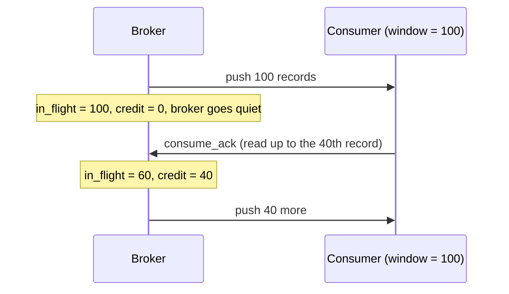
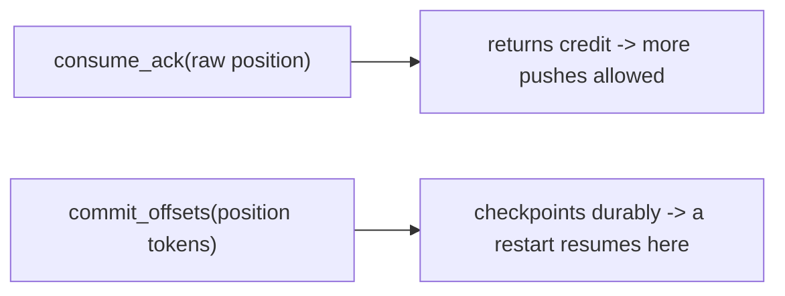

# Streaming with backpressure

[Produce and consume](produce-and-consume.md) covers polling: the client asks, the server answers. This
guide covers the push direction, where the server sends records as they are produced, and the flow control
that keeps a fast producer from burying a slow consumer.

## Why a credit window

Server push without flow control is a loaded gun. If the broker sends every record the moment it lands,
a consumer that processes slower than the producer appends accumulates an unbounded mailbox until the node
runs out of memory. The consumer never gets to say "stop".

Malachi makes the consumer's capacity explicit. A **consume stream** (`open_consume`, `Malachi.Wire` key
29) reads one range, and declares a **window**: the maximum number of records that may be in flight on
it, meaning pushed but not yet acked. The broker will not exceed it.



> **Analogy.** The window is a kitchen pass. The broker sends out up to N plates; it cannot send more until
> you hand plates back (each `consume_ack` returns credit). A slow consumer simply gets fewer plates, and
> the kitchen never buries it under a pile it cannot clear.

Each push is a `records` page: at most `max` records and about `max_bytes` bytes, always at least one
record however large, so the byte limit is a soft one. The server caps them: a window at 10,000 records, a
page at 1,000 records and at `MALACHI_MAX_INFLATED_BATCH_BYTES` (16 MiB by default). Every record in a page
comes with its raw position in the range's history, and the page says where the next one starts twice:
raw, for `consume_ack`, and as an opaque token, to resume from or commit. When the
stream's credit reaches zero the broker stops pushing on it and does no further work for it. Backpressure
here is the absence of sends, not a queue building up somewhere.

A stream pushes only records a replication quorum acknowledged, so a consumer never reads a record its
producer was not told is stored.

## Streaming from the shell

```bash
node subscriber.js orders --window 500
```

`subscriber.js` reads the topic's routes, opens one consume stream per range at the broker that leads it,
from the start of its history, and acks every page it reads. `--window` (100 by default) is each stream's
credit and `--max` (100) the records per push. In Elixir, `Malachi.Loadtest.Consumer` is the same client,
event driven, as `mix malachi.loadtest --scenario stream` runs it.

The stream ends with a `moved` push when the range moves on: a split or merge retires it, or its next
active segment opens on another node. The client reads the routes again and opens the ranges they name: one
whose keys a range it read held (a split's child) from the position it read there, which names the same
record or one before it, and any other from the start of its history, so a record is read at least once and
never lost.

## The ack returns credit, the commit checkpoints

`consume_ack` (key 30) names the raw position the consumer has read up to (the page's raw next), which
frees every page whose last record ends at or before it, and can set a new window (0 leaves it as it is). It does **only** that. The
stream carries no consumer group, so an ack checkpoints nothing: a group's position moves with
`commit_offsets` (key 34), a separate unary request that takes the page's token.



> **Analogy.** Handing a plate back to the kitchen frees a slot for the next plate (credit). Telling the
> manager which orders are served (commit) is a separate trip, and only that one is written in the book a
> restart reads from.

Keeping them apart is what lets you choose: ack as you read to keep the stream flowing, and commit once
the records are processed. Commit a page before you process it and you have converted at-least-once into
at-most-once, silently. `subscriber.js --group` commits each page's position after it has read it.

Delivery is **at-least-once**, same as polling: a crash between a page and its commit re-delivers it. The
idempotency obligation from [Produce and consume](produce-and-consume.md#at-least-once-and-what-it-costs-you)
applies unchanged.

## Sizing the window

The window is a latency/throughput dial, not a correctness setting.

- **Too small** and the consumer idles between pushes, waiting on round trips. The floor is your
  processing time per record times the round-trip time.
- **Too large** and you are back to a large mailbox, with the added cost that everything read and not yet
  committed is re-delivered on a crash.

Start at a few times the batch size you actually process at once, and raise it only if the consumer is
demonstrably starved. The default of 100 is a reasonable place to begin. Each range has a stream of its
own, so the total in flight is the window times the number of ranges read.

> **Analogy.** The window is a Goldilocks dial. Too small and the consumer keeps waiting on the next
> delivery; too large and you are back to a pile that all has to be re-sent after a crash. Aim for "just
> enough in flight to stay busy".

## Parallel streaming with members

One subscriber reads the whole topic. To spread the load, run several members of one group:

```bash
node subscriber.js orders --group live --member m1 &
node subscriber.js orders --group live --member m2 &
```

Each joins the group (`join_group`, key 32), which hands it a share of the topic's ranges, and opens a
consume stream only for those, from the group's checkpoint. Each stream carries its **own** window, so
total in-flight is the sum across them.

> **Analogy.** Each member is its own faucet with its own credit window; the total flow to the group is the
> sum of the faucets. Add members to open more faucets, up to the number of ranges to hand out.

### Members must keep heartbeating

Membership lives beside the streams, not in them. A member stays in the group by sending
`group_heartbeat` (key 33) within its session (`MALACHI_GROUP_SESSION_MS`, 30 s by default), and the
heartbeat's answer is how it learns of a rebalance: its ranges, generation and session again. Reading and
acking do not count as a heartbeat, and a consume stream that closes or drops does not take the member out
of the group.

A member that stops heartbeating, because it is busy rather than dead, is eventually treated as gone and
has its ranges reassigned. `subscriber.js` and `consumer.js` with `--group` heartbeat on their own, every
third of the group's session, apart from the data they read, and leave the group (`leave_group`, key 7)
when they stop, so their ranges go to the others without waiting out the session.

If you implement your own client, this is the part most likely to bite: a member whose streams are busy
but that never heartbeats looks exactly like a dead one.

> **Analogy.** A heartbeat is answering roll call. A member that stays silent, even if it is busy reading,
> is eventually marked absent and has its work handed to someone else.

## Choosing between push and poll

| | poll (`fetch_range`) | push (`open_consume`) |
|---|---|---|
| who drives | client asks | server sends |
| flow control | implicit, you ask when ready | explicit credit window |
| idle cost | a long-poll held open | nothing in flight |
| best for | batch jobs, scans, simple consumers | low-latency fan-out to live consumers |

Both read positions in the same histories and commit through the same group keys, so you can move a
workload from one to the other without losing position.

> **Analogy.** Push is a newspaper subscription: it arrives at your door as it is printed. Poll is checking
> your mailbox when you feel like it. Same news, different way of getting it, and you can switch without
> losing your place.
